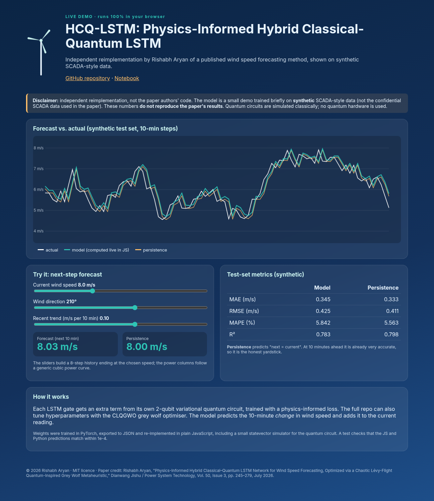

<p align="center"></p>

# HCQ-LSTM + CLQGWO: Physics-Informed Hybrid Classical-Quantum LSTM with Chaotic Lévy-Flight Quantum-Inspired Grey Wolf Optimizer (Reference Implementation)

[](https://rishabh-bgp.github.io/hcq-lstm-clqgwo-wind-forecasting/) [](https://github.com/Rishabh-bgp/hcq-lstm-clqgwo-wind-forecasting/actions/workflows/ci.yml) [](https://colab.research.google.com/github/Rishabh-bgp/hcq-lstm-clqgwo-wind-forecasting/blob/main/notebooks/hcq-lstm-clqgwo-wind-forecasting_walkthrough.ipynb) [](LICENSE)  

> **Reference implementation.** This is the reference implementation of my paper (Rishabh Aryan), rebuilt in Python on synthetic data because the original data is confidential. Results will differ from the published numbers. Authors: Rishabh Aryan (sole author). All quantum components run **on a classical simulator only** (PennyLane `default.qubit`, CPU, 4 qubits, 1 layer per gate by default).
> Results from this code **will differ** from the published results, and the numbers reported in the paper have **not** been reproduced here.

**Keywords:** physics-informed neural network, quantum LSTM, hybrid classical-quantum, grey wolf optimizer, Lévy flight, chaotic map, metaheuristic, Kolmogorov spectrum, wind speed forecasting, PennyLane, PyTorch

## Paper · 論文

Rishabh Aryan, "Physics-Informed Hybrid Classical–Quantum LSTM Network for Wind Speed Forecasting, Optimized via a Chaotic Lévy-Flight Quantum-Inspired Grey Wolf Metaheuristic," *Dianwang Jishu / Power System Technology*, Vol. 50, Issue 3, pp. 245–279, July 2026.

Authors: Rishabh Aryan (sole author). Any simplifications in this Python rebuild are noted under Limitations.

## Method · 方法

1. **HCQ-LSTM cell:** a standard LSTM cell in which each of the four gates (input, forget, output, candidate) gets an extra term from its own small variational quantum circuit (angle encoding, RY/RZ, CNOT ring, ⟨Z⟩ read-out, then a linear map back to the hidden size).
2. **Physics-informed loss:** MSE plus three simplified penalties: a log-law consistency term (with a single hub height it reduces to staying close to the last observed speed), a mean-momentum term penalizing unphysically large one-step accelerations, and a **spectral term** pushing the log-log slope of the forecast power spectrum toward Kolmogorov's −5/3.
3. **CLQGWO:** a grey wolf optimizer with tent-map chaotic initialization, quantum-rotation-gate position perturbation and Lévy-flight exploration. It tunes hidden size, learning rate and the three physics-loss weights (`--tune`).

These physics terms are simplified versions of the paper's; they are documented in `src/hcq_lstm.py`.

## Architecture · 架構

```
for t in 1..T:  z=[x_t, h]
   gate_k = W_k z + Post_k( VQC_k( tanh(P z)·π/2 ) )   k ∈ {i,f,o,g}
   c = σ(f)c + σ(i)tanh(g);  h = σ(o)tanh(c)
ŷ = Linear(h)
loss = MSE + λ1·L_log + λ2·L_mom + λ3·L_spec(−5/3)
CLQGWO → (hidden, lr, λ1, λ2, λ3)
```

## Data · 數據

The original SCADA data used in the paper is confidential and **not publicly available**, so it is not included here (everything in `data/` except the bundled synthetic CSV is git-ignored).
`src/data.py` provides:

- `load_scada_csv(path)`: loads a SCADA-style CSV with columns for timestamp, wind speed (m/s), wind direction (°),
  theoretical power and active power. It accepts both snake_case names (`timestamp, wind_speed, wind_direction,
  theoretical_power, active_power`) and the common Kaggle-style headers
  (`Date/Time, LV ActivePower (kW), Wind Speed (m/s), Theoretical_Power_Curve (KWh), Wind Direction (°)`).
- `synthetic_scada(n)`: an offline synthetic fallback (diurnal + weekly cycles, AR(1) turbulence, a cubic power curve and
  noisy active power). It is generated by script, so no download or account is needed:
  `python scripts/make_synthetic.py --n 3000`.

**Bundled synthetic dataset:** `data/synthetic/synthetic_scada.csv` (600 rows, 10-minute steps, seed 0) is **synthetic data generated by `scripts/make_synthetic.py`**. It is **not** the confidential SCADA data used in the paper and has no connection to any real wind farm. `train.py` uses it by default. To use your own data locally, pass `--csv path/to/scada.csv`. Anything else you put in `data/` is git-ignored, so real data is never committed.

Features per time step are wind speed, sin/cos of direction, theoretical power and active power (kW/1000), standardized
on the training split. The target is wind speed `horizon` steps ahead. The data is split chronologically 70/15/15.

## How to run · 執行

```bash
python -m venv .venv && source .venv/bin/activate
pip install -r requirements.txt

# quick smoke test (< 1 minute on a CPU) on the bundled synthetic data
python train.py --quick --tune

# full run on your own SCADA-style CSV
python train.py --csv path/to/scada.csv --epochs 30 --tune --wolves 8 --iters 10
```

The script prints and saves (`results/*_metrics.json`) **MAE, RMSE, MAPE and R²** on the chronological test split, plus a
naive persistence baseline for comparison. MAPE uses a 0.5 m/s floor in the denominator so calm periods don't blow it up.

## Results (synthetic data only) · 結果

These come from `python train.py --quick --tune` (the last 500 rows of the bundled synthetic CSV, CLQGWO with 3 wolves × 1 iteration (1 epoch each), then 1 training epoch, look-back 12, seed 42) on **synthetic data**, just to check that the pipeline works
end to end. They say nothing about the method's real accuracy. At this budget the model has not converged and is **worse than persistence**.

| Metric | Model | Persistence |
|---|---|---|
| MAE | 1.102 | 0.324 |
| RMSE | 1.358 | 0.400 |
| MAPE (%) | 20.263 | 5.371 |
| R² | -1.012 | 0.823 |

## Live demo · 演示

**[https://rishabh-bgp.github.io/hcq-lstm-clqgwo-wind-forecasting/](https://rishabh-bgp.github.io/hcq-lstm-clqgwo-wind-forecasting/)** runs entirely in your browser. A small version of the model (trained briefly on the bundled synthetic CSV to predict the 10-minute change in wind speed) is exported to JSON by `web/export_model.py`, and its forward pass is re-implemented in plain JavaScript (`site/model.js`), including a small statevector simulator for the quantum circuit. `tests/test_js_parity.py` checks that the JS and PyTorch predictions agree within 1e-4. The page shows a forecast chart against persistence, sliders for wind inputs, the metrics and the disclaimer.



## Notebook · 筆記本

[`notebooks/hcq-lstm-clqgwo-wind-forecasting_walkthrough.ipynb`](notebooks/hcq-lstm-clqgwo-wind-forecasting_walkthrough.ipynb) [](https://colab.research.google.com/github/Rishabh-bgp/hcq-lstm-clqgwo-wind-forecasting/blob/main/notebooks/hcq-lstm-clqgwo-wind-forecasting_walkthrough.ipynb) is a short, beginner-friendly walkthrough: load the synthetic CSV, quick EDA plots, a small version of the model, brief training and a comparison with a persistence baseline. It works when opened on its own in Colab (it fetches the repo code and data). It uses **synthetic data only** and does **not** reproduce the paper's results.

## Tests · 測試

```bash
pytest -q
```

## Repository layout · 結構

```
├── train.py              # train + evaluate (MAE/RMSE/MAPE/R²)
├── scripts/make_synthetic.py
├── src/
│   ├── data.py           # SCADA CSV loader, synthetic generator, windowing
│   ├── metrics.py
│   ├── qlayer.py         # simulator-only VQC (PennyLane)
│   ├── train_common.py
│   └── hcq_lstm.py
├── requirements.txt  LICENSE  .gitignore
```

## Limitations · 局限

- The paper's Kaimal-spectrum synthetic ABL benchmark is not reproduced; this repo uses the simpler generator in `src/data.py`.
- The quantum-measurement-ensemble uncertainty procedure and Wilcoxon tests are not implemented.
- Four VQCs per time step make training slow; keep look-back and data small on CPU.
- Simulated quantum circuits scale exponentially with qubit count, so the defaults use few qubits. Larger settings will be slow on CPU.

## License · 許可證

MIT © 2026 Rishabh Aryan. See [LICENSE](LICENSE). The paper itself remains under its publisher's terms.

## M.Tech Thesis Work in AI and Data Science, IIIT Bhagalpur · 學位論文

*An Investigation into Advanced Techniques for Wind Speed Forecasting with Applications to Renewable Energy Grid Integration*

This repository is part of my M.Tech thesis work.

### Quantum and hybrid quantum machine learning

| | Repository | Approach | Live |
|:---:|---|---|---|
| `08 ☰ 乾 Qian` | [hybrid-vqc-wind-speed-forecasting](https://github.com/Rishabh-bgp/hybrid-vqc-wind-speed-forecasting) | Hybrid variational quantum circuit (Conv1D-LSTM + VQC), PyTorch + PennyLane | [demo](https://rishabh-bgp.github.io/hybrid-vqc-wind-speed-forecasting/) |
| `10 ☵ 坎 Kan` | [cbma-tn-vqc-wind-green-hydrogen](https://github.com/Rishabh-bgp/cbma-tn-vqc-wind-green-hydrogen) | CNN-BiLSTM-MultiHead attention + tensor-network VQC, wind forecasting for green hydrogen | [demo](https://rishabh-bgp.github.io/cbma-tn-vqc-wind-green-hydrogen/) |
| `12 ☶ 艮 Gen` | **hcq-lstm-clqgwo-wind-forecasting** (this repo) | Physics-informed hybrid classical-quantum LSTM tuned by a chaotic Lévy-flight quantum-inspired grey wolf optimizer | [demo](https://rishabh-bgp.github.io/hcq-lstm-clqgwo-wind-forecasting/) |

### Metaheuristic-optimized hybrids

| | Repository | Approach | Live |
|:---:|---|---|---|
| `04 ☷ 坤 Kun` | [geoai-hybrid-ga-pso-anfis-wind-forecasting](https://github.com/Rishabh-bgp/geoai-hybrid-ga-pso-anfis-wind-forecasting) | GeoAI hybrid: GA → PSO → ANFIS → CNN-LSTM probabilistic multi-site forecasting | [demo](https://rishabh-bgp.github.io/geoai-hybrid-ga-pso-anfis-wind-forecasting/) |

### Deep learning with attention and gating

| | Repository | Approach | Live |
|:---:|---|---|---|
| `01 ☴ 巽 Xun` | [cnn-bilstm-attention-synthetic-scada](https://github.com/Rishabh-bgp/cnn-bilstm-attention-synthetic-scada) | CNN-BiLSTM-Attention on synthetic SCADA-style data vs ARIMA, LSTM, XGBoost, Random Forest and SVR | [demo](https://rishabh-bgp.github.io/cnn-bilstm-attention-synthetic-scada/) |
| `02 ☳ 震 Zhen` | [cnn-bilstm-attention-real-scada](https://github.com/Rishabh-bgp/cnn-bilstm-attention-real-scada) | CNN-BiLSTM-Attention pipeline for real turbine SCADA data (run here on synthetic data, the real data is confidential) | [demo](https://rishabh-bgp.github.io/cnn-bilstm-attention-real-scada/) |
| `03 ☰ 乾 Qian` | [cnn-bilstm-attention-benchmarking-indian-scada](https://github.com/Rishabh-bgp/cnn-bilstm-attention-benchmarking-indian-scada) | Benchmark of CNN-BiLSTM-Attention vs ANN, LSTM, SVM and ARIMA-ANN with Diebold-Mariano tests | [demo](https://rishabh-bgp.github.io/cnn-bilstm-attention-benchmarking-indian-scada/) |
| `05 ☲ 離 Li` | [xai-shap-lime-cnn-bilstm-attention-wind](https://github.com/Rishabh-bgp/xai-shap-lime-cnn-bilstm-attention-wind) | Explainable CNN-BiLSTM-Attention forecasting with SHAP and LIME | [demo](https://rishabh-bgp.github.io/xai-shap-lime-cnn-bilstm-attention-wind/) |
| `06 ☲ 離 Li` | [wind-forecasting-mathematical-formulations-validation](https://github.com/Rishabh-bgp/wind-forecasting-mathematical-formulations-validation) | Equation-by-equation ANN, LSTM/BiLSTM, SVR, ARIMA-ANN and CNN-BiLSTM-Attention with optimizer, learning-rate and statistical validation studies | [demo](https://rishabh-bgp.github.io/wind-forecasting-mathematical-formulations-validation/) |
| `09+13 ☵ 坎 Kan` | [wuweidl-daoist-gated-wind-forecasting](https://github.com/Rishabh-bgp/wuweidl-daoist-gated-wind-forecasting) | WuWeiDL: Wu Wei gating and Feng-Qi turbulence encoding | [demo](https://rishabh-bgp.github.io/wuweidl-daoist-gated-wind-forecasting/) |
| `16 ☴ 巽 Xun` | [rso-net-wind-grid-stabilization](https://github.com/Rishabh-bgp/rso-net-wind-grid-stabilization) | RSO-Net: recursive self-optimizing TCN-Attention probabilistic forecasting with grid-stabilization proposals | [demo](https://rishabh-bgp.github.io/rso-net-wind-grid-stabilization/) |

### IoT, automation and multi-agent systems

| | Repository | Approach | Live |
|:---:|---|---|---|
| `14 ☳ 震 Zhen` | [iot-n8n-wind-turbine-predictive-maintenance](https://github.com/Rishabh-bgp/iot-n8n-wind-turbine-predictive-maintenance) | IoT + forecasting + n8n automation for wind-turbine predictive maintenance | [demo](https://rishabh-bgp.github.io/iot-n8n-wind-turbine-predictive-maintenance/) |
| `15 ☱ 兌 Dui` | [multi-agent-turbine-fleet-chief-of-staff](https://github.com/Rishabh-bgp/multi-agent-turbine-fleet-chief-of-staff) | Multi-agent AI chief of staff for wind-turbine fleet operations | [demo](https://rishabh-bgp.github.io/multi-agent-turbine-fleet-chief-of-staff/) |

### Statistical time-series models

| | Repository | Approach | Live |
|:---:|---|---|---|
| `07 ☵ 坎 Kan` | [arima-sarima-wind-speed-chennai](https://github.com/Rishabh-bgp/arima-sarima-wind-speed-chennai) | ARIMA(3,0,2) and SARIMA(0,1,2)(0,1,2,4) daily wind speed forecasting for Chennai | [demo](https://rishabh-bgp.github.io/arima-sarima-wind-speed-chennai/) |

## Other repositories by Rishabh Aryan · 其他

- [beed-ml-study](https://github.com/Rishabh-bgp/beed-ml-study)
- [pan-cancer-classification](https://github.com/Rishabh-bgp/pan-cancer-classification)
- [spam-scan](https://github.com/Rishabh-bgp/spam-scan)
- [real-estate-valuation-taiwan](https://github.com/Rishabh-bgp/real-estate-valuation-taiwan)
- [boston-house-price-prediction](https://github.com/Rishabh-bgp/boston-house-price-prediction)
- [california-house-price-prediction](https://github.com/Rishabh-bgp/california-house-price-prediction)
- [iris-classification](https://github.com/Rishabh-bgp/iris-classification)
- [machine-learning-part-1](https://github.com/Rishabh-bgp/machine-learning-part-1)
- [machine-learning-part-2](https://github.com/Rishabh-bgp/machine-learning-part-2)
- [machine-learning-part-3](https://github.com/Rishabh-bgp/machine-learning-part-3)
- [All repositories](https://github.com/Rishabh-bgp?tab=repositories)
